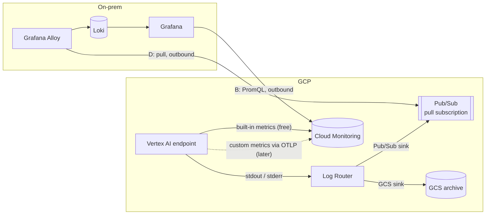
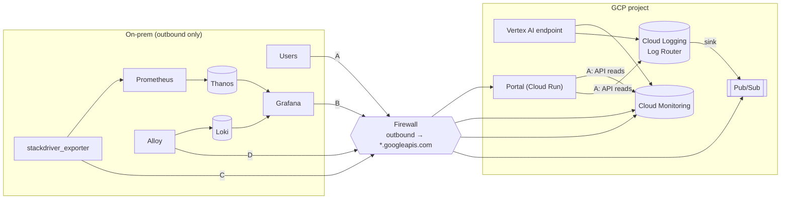
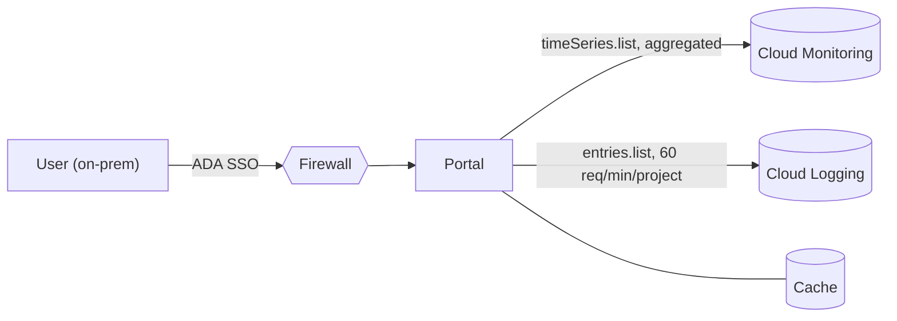
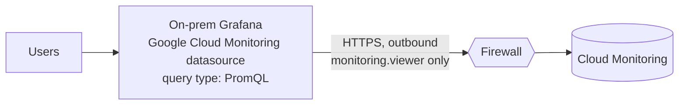
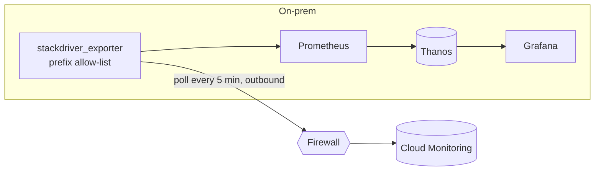
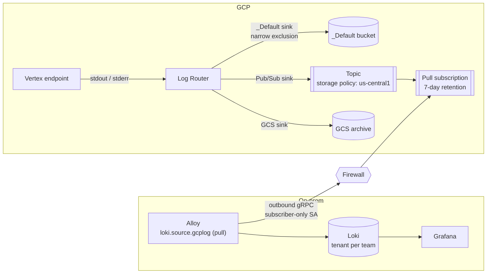
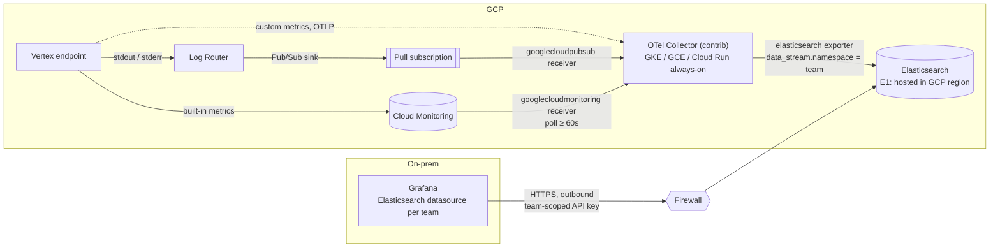

# Vertex AI endpoint observability without console access

**Status:** Analysis complete. Recommendation proposed, pending the on-prem spike.
**Date:** 2026-10-23
**Scope:** Logs and operational metrics for Vertex AI online prediction endpoints (`mle-project-496007`, `us-central1`), delivered to users who have no GCP console access.
**Related:** [Logging-cost levers](2026-09-09-vertex-logging-cost.md) · [Exclusion + GCS sink runbook](logs-exclusion-gcs-sink.md) · [Endpoint access control](superpowers/specs/2026-09-24-endpoint-access-control-design.md)

---

## 1. Summary

Today, the only way to see endpoint logs and metrics is the GCP console under *Vertex AI → Endpoints*. Users, including engineers on consuming teams, will not get console access. We need another way to retrieve and render this data that fits a **one-way network** (on-prem → GCP only) and reuses the **existing on-prem Grafana, Prometheus and Thanos stack**.

**Recommendation:**

| Signal | Approach | Why |
|---|---|---|
| **Metrics** | **Option B:** on-prem Grafana queries Cloud Monitoring with PromQL | Near-zero build, pull-only, built-in metrics are free to ingest. Proven locally |
| **Logs** | **Option D:** Log Router sink → Pub/Sub → on-prem Alloy (pull) → Loki | Avoids the hard 60 req/min read quota, keeps PII scoped per team, ≈ $7 per 100 GiB |
| **Custom model metrics** | **Defer.** When needed: OTel SDK → OTLP → Cloud Monitoring | Sample-based billing is ~25× cheaper for histograms. Shows up in B with no new infrastructure |
| **Portal** | Link out to Grafana dashboards; don't rebuild charts | Grafana already does it, with alerting |

**Alternative (option E, §4.5):** if Elastic is the enterprise observability standard and a cluster can be hosted in GCP, one OTel Collector in GCP can ship logs and metrics to Elasticsearch, viewed through Grafana's Elasticsearch datasource. It's simpler to reason about (one pipeline, one store), but it gives up PromQL and Thanos for metrics and adds an Elasticsearch cluster as the dominant cost.



**The single most important lever isn't a tool choice:** cut log volume at the source (log level, no payload logging, no health-probe lines). It improves cost, quota headroom, PII exposure, Loki capacity and search quality at the same time.

**Indicative running cost** (list prices, a 20-endpoint fleet, 100 GiB of logs per month after source reduction): **≈ $35–$85/month**, dominated by dashboard reads and `_Default` storage. Details are in §6.

---

## 2. Problem and constraints

### 2.1 Requirements

| # | Requirement |
|---|---|
| R1 | Users without GCP console access can see endpoint health (traffic, latency, errors, utilisation, replicas) |
| R2 | Users can search the prediction container's logs for their own models |
| R3 | Access is scoped per team or model; logs can contain PII (`race`, `sex`, `marital_status`, … in the census payload) |
| R4 | Works over a **one-way** network: on-prem can reach Google APIs through a per-destination firewall whitelist; GCP cannot initiate connections to on-prem |
| R5 | Reuses the existing on-prem **Grafana + Prometheus + Thanos** stack where possible |
| R6 | Predictable cost, including at high cardinality and with many viewers |

### 2.2 The two APIs everything sits on

- **Cloud Logging API v2** ([overview](https://docs.cloud.google.com/logging/docs/reference/api-overview)):
  - `entries.list` reads log buckets.
  - Google states it is *"not intended for high-volume retrieval"* and recommends sinks for bulk.
  - **Quota: 60 requests/min per project, not increasable.**
- **Cloud Monitoring API v3** ([overview](https://docs.cloud.google.com/monitoring/api/v3)):
  - `timeSeries.list` (filters plus server-side aggregation).
  - A **PromQL** endpoint (`projects.location.prometheus.api.v1`).
  - `timeSeries.create` for custom metrics.
  - MQL (`timeSeries.query`) lost Google customer support on 2025-07-22, so don't build on it.
  - Metric retention: 24 months (raw for 6 weeks, then 10-minute downsampling).

Because of R4, every viable design has **on-prem pull from Google APIs**. Prometheus `remote_write`, OTLP push, Thanos Receive and Pub/Sub *push* subscriptions are ruled out.

---

## 3. What we need to observe

### 3.1 Metrics: three cost categories

A metric's cost category is set by **its prefix and how it was sent**, not by what it measures ([pricing](https://cloud.google.com/stackdriver/pricing), checked 2026-10-23).

| | **Built-in** | **Custom, byte-based** | **Custom, sample-based** |
|---|---|---|---|
| Prefixes | `aiplatform.googleapis.com/prediction/online/*` | `custom.`, `workload.`, `external.googleapis.com/*`, user-defined log-based metrics | `prometheus.googleapis.com/*` (OTLP, Managed Prometheus) |
| Emitted by | Vertex AI, automatically | Our predictor | Our predictor |
| Answers | *Is the endpoint healthy?* | *Is the model behaving?* | *Is the model behaving?* |
| Examples | `prediction_count`, `response_count`, `error_count`, `prediction_latencies` (distribution → p50/p95/p99), `cpu/utilization`, `memory/bytes_used`, `accelerator/*`, `replicas` | Prediction-class mix, confidence histogram, feature null rate | Same |
| Labels | Fixed by Google (`endpoint_id`, `deployed_model_id`, `response_code`, …) | Ours: ≤30 per metric, ≤200k active series per resource | Ours |
| Metered as | Not metered | 8 B per scalar point, 80 B per distribution point | 1 sample per scalar point; distribution = 2 + 1 per non-zero bucket |
| Ingest price | **Free** | $0.258/MiB (tiered down to $0.061) | $0.06 per M samples (tiered down to $0.024) |
| Free allotment | n/a | 150 MiB per billing account per month | None |

The built-in metrics fully satisfy **R1**. Custom metrics are only needed for model-quality questions, which aren't in scope today (§9).

### 3.2 Logs

- The prediction container's stdout/stderr is forwarded to Cloud Logging under `resource.type="aiplatform.googleapis.com/Endpoint"`.
- Volume = verbosity × health-probe frequency × replicas + per-request lines.
- The earlier logging-cost work found the container writes **two lines per health probe, forever, even at zero traffic**, plus full request payloads at INFO. That makes it both a cost problem and a PII problem.

---

## 4. Options



| Option | Signal | Summary | Build effort |
|---|---|---|---|
| **A** Portal UI | Metrics + logs | The portal calls the Monitoring/Logging APIs and renders its own charts and log table | High |
| **B** Grafana → Cloud Monitoring | Metrics | On-prem Grafana queries Cloud Monitoring live with PromQL | **Low** |
| **C** Exporter → Thanos | Metrics | An on-prem exporter polls Cloud Monitoring into Prometheus/Thanos | Medium |
| **D** Sink → Pub/Sub → Loki | Logs | A Log Router sink streams logs to Pub/Sub; on-prem Alloy pulls them into Loki | Medium |
| **E** Collector in GCP → Elasticsearch | Metrics + logs | An OTel Collector in GCP gathers logs (Pub/Sub) and metrics (Cloud Monitoring, OTLP) into Elasticsearch; Grafana reads it via the Elasticsearch datasource | Medium–High |

### 4.1 Option A: portal UI on the Logging and Monitoring APIs

The portal (in GCP) calls `timeSeries.list` (aggregated) and `entries.list`, maps the user's ADA SSO group to permitted `endpoint_id`s, and renders the results.



| Pros | Cons |
|---|---|
| One URL and one auth model; users need no GCP identity | Rebuilds Grafana: charts, time pickers, log search, pagination |
| Fine-grained per-model authorization, which matters for PII | **Logs are capped by the 60 req/min `entries.list` quota**, shared project-wide; needs caching and rate limits |
| Full control of aggregation, so read cost is bounded by design | No alerting, ad-hoc exploration or correlation with on-prem dashboards |
| | Only sees logs that are **stored in a log bucket**, so it breaks if `_Default` excludes them (§7) |

### 4.2 Option B: on-prem Grafana queries Cloud Monitoring (recommended for metrics)

Add Grafana's built-in **Google Cloud Monitoring** datasource (it appears as `stackdriver` in the datasource picker) to the existing on-prem Grafana. Query it with the **PromQL** query type. The data stays in GCP; Grafana reads it on each refresh.



**How:**
1. Create a service account with `roles/monitoring.viewer` only. Use Workload Identity Federation if available; otherwise a key in Grafana's secret store.
2. Whitelist `monitoring.googleapis.com` and `oauth2.googleapis.com`, or the `private.googleapis.com` /30.
3. Build dashboards with one PromQL expression per query, always aggregated. Set the minimum interval to 1m or more and the refresh to 1m or more.
4. Create one Grafana folder per team, with an `endpoint_id` variable.

| Pros | Cons |
|---|---|
| Reuses existing dashboards, alerting and PromQL skills. Days, not weeks | One service account sees all project **metrics**. Scoping is by Grafana folder. Acceptable because metrics carry no PII |
| Pull-only, one firewall entry, no new infrastructure | **Every refresh is a billable read** ($0.50 per M series). Unaggregated dashboards get expensive (§6.2) |
| Built-in metrics are free to ingest; custom OTLP metrics appear automatically | History is GCP's (24 months, downsampled after 6 weeks), not Thanos |

Don't use Grafana's Cloud Logging datasource the same way: it would give Grafana project-wide access to PII-bearing logs. Use D for logs.

### 4.3 Option C: exporter → on-prem Prometheus/Thanos

An exporter **running on-prem** (`prometheus-community/stackdriver_exporter`) polls Cloud Monitoring on a fixed schedule. Prometheus scrapes it into Thanos.



**How:**
- Use the same service account and firewall entry as B.
- Exporter settings:
  - `--monitoring.metrics-type-prefixes=aiplatform.googleapis.com/prediction/online`, adding `prometheus.googleapis.com/<custom prefix>` once custom metrics exist.
  - `--monitoring.metrics-interval=5m`
  - `--monitoring.metrics-offset=3m`
  - The project flag (`--google.project-ids` or `--google.project-id`) depends on the release.
- Add recording rules for p95 latency and error rate per endpoint.

| Pros | Cons |
|---|---|
| One long-term store with on-prem retention, recording rules and correlation | We own the exporter: config, prefix allow-list, lag tuning |
| Read cost is fixed by the poll schedule, **independent of viewer count** | Polling lag of 5–8 minutes on top of GCP's ingest delay |
| Also carries custom `prometheus.googleapis.com` metrics, so a GCP-side collector is rarely needed | Cardinality moves into Thanos unless the exporter is filtered |
| | Metrics only; logs still need D |

A variant (C2) puts an OTel Collector in GCP behind a public authenticated `/metrics` endpoint, scraped by on-prem Prometheus (outbound from on-prem). It's only worth it if custom metrics must bypass Cloud Monitoring entirely, which no current requirement needs.

### 4.4 Option D: Log Router sink → Pub/Sub → on-prem Loki (recommended for logs)

A **Log Router sink** streams matching Vertex log entries into a Pub/Sub topic. On-prem **Grafana Alloy** pulls from a subscription (outbound only) and writes to Loki. Users search logs in the existing Grafana, scoped by Loki tenant.



| Pros | Cons |
|---|---|
| **No `entries.list` quota involved**; near-real-time | New components to run: sink, topic, Alloy, Loki capacity |
| PII stays scoped per team in Loki; Grafana never gets project-wide log access | Loki storage, retention and limits become our responsibility |
| Cheap: Pub/Sub ≈ $7 per 100 GiB (§6.3) | Delivers only entries routed after the sink exists, so no backfill from Pub/Sub |
| Buffered: an on-prem outage loses nothing within the 7-day subscription retention | Logs leave GCP, so they need egress capacity and a residency decision (§8) |

Implementation steps and commands are in [Appendix A](#appendix-a--option-d-setup).

### 4.5 Option E: OTel Collector in GCP → Elasticsearch, viewed in Grafana

A single **OpenTelemetry Collector running in GCP** gathers every signal and ships it to **Elasticsearch**. Users read both logs and metrics in Grafana through the **Elasticsearch datasource** (or in Kibana). It replaces B and D with one pipeline and one store.



**Where Elasticsearch lives decides whether E fits the network:**

| Variant | Elasticsearch location | Network fit (R4) |
|---|---|---|
| **E1 (viable)** | In GCP: Elastic Cloud on GCP in `us-central1`, or self-managed with ECK on GKE | ✅ The collector writes within GCP; on-prem Grafana **pulls** from Elasticsearch over outbound HTTPS. One new firewall entry: the Elasticsearch endpoint |
| E2 | The existing on-prem cluster | ❌ The collector in GCP must **push into on-prem**, which needs an inbound path (DMZ ingress or Interconnect) and security approval. If that path is approved, the rest of the design is unchanged |

**How each signal flows:**

| Signal | Collector pipeline | Notes |
|---|---|---|
| **Logs** | D's sink → Pub/Sub topic → a dedicated pull subscription → `googlecloudpubsub` receiver with the **`googlecloudlogentry` encoding extension** → `elasticsearch` exporter | The receiver's built-in `cloud_logging` encoding **was removed in v0.132.0**; use the extension. Receiver stability: beta. Same staged exclusion strategy as §7 |
| **Built-in metrics** | `googlecloudmonitoring` receiver polls `aiplatform.googleapis.com/prediction/online/*` → `elasticsearch` exporter | Receiver stability: **alpha**. Minimum interval 60s, default 300s. Read cost is fixed by the poll, independent of viewers (≈ $2/month for 120 series at 60s, as in option C) |
| **Custom metrics** | Predictor OTel SDK → OTLP → collector `otlp` receiver → `elasticsearch` exporter | Skips Cloud Monitoring ingest entirely (no §6.4 cost), but these metrics then exist **only in Elasticsearch**. Needs a predictor → collector path inside GCP (authenticated Cloud Run URL or internal load balancer); Vertex egress to it is unverified |

**Implementation notes:**
- **Collector hosting:**
  - Pull receivers need continuous CPU: GKE, GCE, or Cloud Run with minimum instances ≥ 1 and CPU always allocated.
  - Run 2+ replicas on the shared Pub/Sub subscription for HA.
  - Run the Cloud Monitoring receiver on **one** replica only, or every replica polls and bills reads.
- **Collector identity:** `roles/pubsub.subscriber` on the subscription plus `roles/monitoring.viewer`, via ADC. No key file inside GCP.
- **Per-team scoping:**
  - Set `data_stream.namespace` to the team: map `endpoint_id` to the team with a `transform` processor.
  - The exporter then writes to `logs-vertex-<team>` / `metrics-vertex-<team>`.
  - Grant each team's Grafana datasource an API key limited to its own indices. Index-level privileges cover R3; document-level security is a paid Elastic feature (unverified) and isn't needed with per-team indices.
- **Elasticsearch version:** the exporter's default `otel` mapping mode needs Elasticsearch ≥ 8.12, and works best on ≥ 8.16.
- **Delivery:** the exporter's in-memory sending queue is on by default. Durability across collector restarts comes from Pub/Sub. Messages are acked only after export, so the 7-day subscription retention still bounds an outage.

Illustrative collector config (field names checked against the contrib READMEs; values to adapt):

```yaml
extensions:
  googlecloudlogentry_encoding: {}

receivers:
  googlecloudpubsub:
    subscription: projects/mle-project-496007/subscriptions/vertex-endpoint-logs-collector
    encoding: googlecloudlogentry_encoding
  googlecloudmonitoring:
    project_id: mle-project-496007
    collection_interval: 60s
    metrics_list:
      - metric_descriptor_filter: 'metric.type = starts_with("aiplatform.googleapis.com/prediction/online/")'
  otlp:
    protocols:
      grpc: { endpoint: 0.0.0.0:4317 }

processors:
  memory_limiter: { check_interval: 1s, limit_percentage: 80 }
  transform/team:            # set data_stream.namespace from an endpoint_id → team mapping
    log_statements: []       # fill in
    metric_statements: []    # fill in

exporters:
  elasticsearch:
    endpoint: https://<es-endpoint>:443
    api_key: ${env:ES_API_KEY}

service:
  extensions: [googlecloudlogentry_encoding]
  pipelines:
    logs:    { receivers: [googlecloudpubsub],            processors: [memory_limiter, transform/team], exporters: [elasticsearch] }
    metrics: { receivers: [googlecloudmonitoring, otlp],  processors: [memory_limiter, transform/team], exporters: [elasticsearch] }
```

| Pros | Cons |
|---|---|
| **One pipeline, one store, one datasource** for logs and metrics. One component, the collector, is the standard OTel tool | **We run or pay for an Elasticsearch cluster.** Likely the largest cost line, and an operational burden unless an Elastic team already owns it |
| Fits R4 (E1): everything GCP-side is internal; on-prem only pulls | Metrics leave the Prometheus world: **no PromQL**, no Thanos retention or correlation, and Elasticsearch is a less efficient metrics store. Reverses R5 for metrics |
| Strong full-text log search (Kibana or Grafana); per-team indices give clean R3 scoping; PII stays in a GCP region we choose | Key receivers are **alpha (Monitoring) and beta (Pub/Sub)**, so pin collector versions and test upgrades. The `cloud_logging` → extension change shows the churn |
| Monitoring read cost is fixed by the poll schedule; custom OTLP metrics skip Cloud Monitoring ingest | One more always-on component in GCP (the collector) that needs HA, monitoring and a single-poller rule |
| Allows a full `_Default` exclusion (stage 4) without losing searchable logs | E2 (on-prem Elastic) needs a GCP → on-prem path, which is a security decision, not just a design choice |

**Cost** at the same scale as §6 (100 GiB/month of logs, 20 endpoints):
- Pub/Sub: ≈ $7.4.
- Monitoring reads from the collector: ≈ $2.
- Collector compute: unverified; one to two small always-on instances.
- **Elasticsearch: unverified and dominant.** Size it as daily ingest × index overhead × (1 + replicas) × retention days, plus metric documents. Compare against Loki on object storage, which is typically cheaper for logs.

**When E beats B + D:** Elastic is already the enterprise observability standard, with an owning team and a GCP-hosted (or approved GCP-reachable) cluster, *and* users prefer Kibana-style search over PromQL dashboards. Otherwise B + D reuses more of the existing on-prem stack for less.

---

## 5. Evaluation

| Criterion | A Portal | B Grafana → CM | C Exporter → Thanos | D Sink → Loki | E Collector → Elastic |
|---|---|---|---|---|---|
| R1 Endpoint health | ✅ | ✅ | ✅ | n/a | ✅ (no PromQL) |
| R2 Log search | ⚠️ quota-bound | ❌ (by design) | ❌ | ✅ | ✅ |
| R3 Per-team scoping | ✅ fine-grained | ⚠️ folder-level | ⚠️ folder-level | ✅ Loki tenant | ✅ per-team indices |
| R4 One-way network | ✅ | ✅ | ✅ | ✅ | ✅ E1 / ❌ E2 |
| R5 Reuse on-prem stack | ❌ | ✅ | ✅ | ✅ | ⚠️ Grafana only |
| R6 Predictable cost | ✅ if cached | ⚠️ grows with viewers | ✅ fixed polling | ✅ volume-based | ⚠️ fixed polling; Elastic cluster dominates |
| Build effort | High | **Low** | Medium | Medium | Medium–High |
| Freshness | ~2–3 min / seconds | ~2–3 min | 5–8 min | Seconds | Logs: seconds; metrics: 1–5 min |

B and D together cover every requirement with the least new code. C is the upgrade path for metrics if R6 starts to bite or long retention is required. E is the alternative to B + D when Elastic is the enterprise standard and can be hosted in GCP.

---

## 6. Cost analysis

All prices are list USD from the [Observability](https://cloud.google.com/stackdriver/pricing) and [Pub/Sub](https://cloud.google.com/pubsub/pricing) pricing pages, checked 2026-10-21 to 2026-10-23. Free allotments are **per billing account** unless noted, so other projects sharing the account consume them too.

### 6.1 Price points that matter

| Item | Price | Free per month |
|---|---|---|
| Built-in metric ingest | Free | n/a |
| Custom metric ingest, byte-based | $0.258/MiB → $0.151 → $0.061 | 150 MiB |
| Custom metric ingest, sample-based | $0.06 per M samples → … → $0.024 | None |
| **Monitoring reads** (`timeSeries.list`, PromQL) | **$0.50 per M time series returned**; each call is billed as max(series, 1) | 1M series |
| Monitoring writes | Free | n/a |
| Log storage in any log bucket | $0.50/GiB one-time, includes 30 days | 50 GiB **per project** |
| Log retention beyond 30 days | $0.01/GiB per month | n/a |
| Log Router routing, Log Analytics SQL, `entries.list` | Free (`entries.list` quota-bound) | n/a |
| Pub/Sub delivery (publish + subscribe) | $40/TiB, 1 KB minimum per request | 10 GiB |
| Pub/Sub Cloud Storage subscription | $50/TiB | None |
| Pub/Sub retained-message storage | $0.27/GiB per month | n/a |
| Alerting policies | $0.35 per metric reference per month, plus $0.50 per M points | From **2027-09-01** |

### 6.2 Metrics: the cost is in reads, not ingest

**Console reads are free.** Reads from client libraries and *"third-party tools like Grafana"* are billed. Moving users off the console turns a free read path into a metered one.

| Dashboard behaviour (20 endpoints × 3 models × 5 response codes × 6 metrics) | Series per refresh | Monthly read cost |
|---|---|---|
| Unaggregated, 30s refresh, 10 viewers | ~1,800 | **≈ $777** |
| `sum by (endpoint_id)`, 1-minute refresh, 10 viewers | 120 | **≈ $25** |
| Same, behind a single poller or cache (option C or a caching proxy) | 120 | **≈ $2** |

Server-side aggregation, minimum intervals and refresh limits are therefore **design requirements** for B, not optimisations. Track the cost with `monitoring.googleapis.com/billing/time_series_billed_for_queries_count`.

### 6.3 Logs

At 100 GiB/month of endpoint logs:

| Item | `_Default` only | + Pub/Sub → Loki | + full `_Default` exclusion |
|---|---|---|---|
| `_Default` storage | ≈ $25–50 (depends on the 50 GiB per-project free tier) | Same | $0 |
| Pub/Sub delivery (≈ 200 GiB of throughput) | n/a | ≈ $7.4 | ≈ $7.4 |
| GCS archive (Standard, regional) | n/a | ≈ $2 per month of data kept, before lifecycle tiering | Same |
| GCP → on-prem egress | n/a | Unverified | Unverified |

Source reduction (§7.1) is worth more than any of these: the earlier work showed idle probe noise alone can dominate volume.

### 6.4 Custom metrics, if added

One series written once a minute is 43,200 points per month:

| Series | Byte-based | Sample-based |
|---|---|---|
| 1 scalar gauge | ≈ $0.085/mo | ≈ $0.003/mo |
| 1 histogram (10 non-zero buckets) | ≈ $0.85/mo | ≈ $0.03/mo |
| 1,000 histograms (e.g. 50 models × 20 label combinations) | **≈ $812/mo** | **≈ $31/mo** |

Cost is series × write frequency, so a bounded label allow-list is the main lever.

---

## 7. Log routing and exclusion strategy

Earlier drafts held two exclusion positions: exclude only the noise, which keeps the portal and Logs Explorer working, and exclude everything once Loki is trusted, which saves the most. They are reconciled here as **one staged strategy**.

### 7.1 How sinks and exclusions interact

```
Logging API ─► Log Router ─┬─► _Default sink  (exclusions) ─► _Default bucket   → Logs Explorer, entries.list
                           ├─► Pub/Sub sink   (own filter) ─► topic → Loki       → Grafana
                           ├─► GCS sink       (own filter) ─► archive bucket     → batch / BigQuery
                           └─► _Required sink (audit logs; cannot be excluded)
```

- **Sinks are independent.** An exclusion drops entries from *its own* sink's destination only. Every other sink still sees every entry. This repo measured it: with a `_Default` exclusion in place, the GCS sink kept receiving the excluded logs.
- **`entries.list` and Logs Explorer only read log buckets.** Anything excluded from `_Default` is invisible to option A, the Grafana Cloud Logging datasource, and the platform team in the console.
- **Exclusions cut storage, not ingestion.** Excluded entries still count toward the write quota and `billing/bytes_ingested`, so verify exclusions with Log Analytics `storage_bytes` instead.

### 7.2 The staged strategy

| Stage | Action | Effect |
|---|---|---|
| **1. Reduce at the source** | Set `LOG_LEVEL=WARNING` and `ACCESS_LOG=false` on the Model; log no payloads above DEBUG; optionally `disable_container_logging` for non-critical endpoints | Fewer bytes everywhere: cost, quotas, PII, Loki load, search quality |
| **2. Narrow exclusion on `_Default`** | Exclude only probe and access noise (by `logName`, found with `tools/logging-cost/discover.py`), optionally `sample(insertId, 0.9)` on high-volume INFO. Keep app logs, warnings and errors | Most of the storage saving; Logs Explorer and any API reader keep working |
| **3. Add the Pub/Sub sink (D)** | Use the same noise-free filter. This is a **separate sink** from the GCS sink | Loki becomes the user-facing log store |
| **4. Optional: full exclusion** | Once Loki has been the trusted system of record for a full retention cycle, exclude all Vertex endpoint logs from `_Default` | Removes the remaining $0.50/GiB. Logs Explorer is gone for these logs, and Loki plus GCS hold the only copies |

Rules that hold at every stage:
- Keep the Pub/Sub and GCS sink filters a superset of everything excluded, or those entries are lost everywhere.
- Scope every exclusion to `resource.type="aiplatform.googleapis.com/Endpoint"`, never project-wide.
- There are at most 50 exclusions per sink, so filter by resource type and labels, never per model.

### 7.3 Where GCS and BigQuery fit

| Need | Path | Notes |
|---|---|---|
| Archive, compliance | **GCS sink** (existing) | Hourly JSON batches, 2–3 h first delay. Routing is free; storage only. Cheaper than a Pub/Sub Cloud Storage subscription ($50/TiB) |
| Occasional SQL over archived logs | GCS → BigQuery external table or scheduled load job | Batch only. `YYYY/MM/DD` paths aren't Hive-partitioned; define `jsonPayload` as a `JSON` column |
| SQL analytics on fresh logs | Separate **sink → BigQuery dataset** (partitioned) | Near-real-time, no `entries.list` quota. BigQuery rates not verified here |
| Portal log view (if ever needed) | Stage 2 narrow exclusion with `entries.list`, or a dedicated log bucket with **per-model log views**, or BigQuery | The portal cannot read GCS interactively or reach on-prem Loki |

---

## 8. Data protection and residency

- **Every copy is a governed copy.** `_Default`, GCS, Pub/Sub and Loki each need IAM, retention and a location. A deletion request spans all four. Minimising at the source (§7.2, stage 1) is the only control that reduces all of them.
- **Least-privilege identities:**
  - Sink writer: `pubsub.publisher` on one topic.
  - On-prem consumer: `pubsub.subscriber` on one subscription.
  - Grafana: `monitoring.viewer`.
  - Nothing on-prem holds Logging roles.
- **Pub/Sub is a buffer, not a store:**
  - Messages are removed once every attached subscription acknowledges them.
  - Unacknowledged messages are kept 7 days by default (configurable from 10 minutes to 31 days). That retention is the **on-prem outage budget**; alert on `subscription/oldest_unacked_message_age`.
  - Replay (retain acknowledged messages or topic retention) costs $0.27/GiB per month. Use GCS for replay instead.
- **Pub/Sub location is not fixed by default:**
  - A topic isn't regional. Messages are stored in *"the nearest Google Cloud region"* to where they enter Google, and with no policy, any region is allowed. For a sink, Google is the publisher.
  - Set a **message storage policy** (`us-central1`) with `enforceInTransit`. On-prem Alloy must then use a regional endpoint.
- **Retention obligations:**
  - Pub/Sub (7 days) and `_Default` (30 days) aren't archives.
  - Any multi-year requirement is met by the GCS bucket's lifecycle and retention lock.
- **Loki tenancy:** one tenant (or label-based access policy) per team, so R3 holds on the log path without per-request authorization code.

---

## 9. Custom model metrics (deferred)

Built-in metrics answer *"is the endpoint healthy?"*. Questions like *"is the model behaving?"* (class mix, confidence drift, feature null rates) need custom metrics emitted by the predictor. There's no named requirement yet, so this is deferred. When one appears:

| Path | Lands as | Verdict |
|---|---|---|
| **OTel SDK → OTLP gRPC → Telemetry API** (`telemetry.googleapis.com`) | `prometheus.googleapis.com/*`, sample-based | **Use this.** In-process, no infrastructure; visible in B and pollable by C |
| OTel SDK → OTel Collector (≥ 0.140.0) → Telemetry API | Same | Only if central filtering or relabeling is needed |
| Monitoring API `create_time_series` | `custom.googleapis.com/*`, byte-based | Fallback; ~25× costlier for histograms |
| Google `CloudMonitoringMetricsExporter` | `workload.googleapis.com/*`, byte-based | Google is steering users to OTLP |
| Ops Agent / Stackdriver Prometheus sidecar | `workload.` / `external.` | Not possible on Vertex (VM-only, or legacy) |

Guardrails:
- Labels come from a fixed allow-list (model, version, class), never request IDs or raw features.
- Export every 60s, off the request path.
- Histograms use few, explicit buckets.
- Vertex can't scrape a container `/metrics` endpoint and has no sidecar, so metrics must be pushed from inside the predictor. Env vars go on the Vertex **Model** (`Model.upload`).

A code sketch is in [Appendix C](#appendix-c--otlp-custom-metric-sketch).

---

## 10. Recommendation and rollout

| Phase | Scope | Exit criteria |
|---|---|---|
| **0. Source reduction** (days) | Stage 1 of §7.2 on every predictor: quiet logging, no payloads | `discover.py` shows probe/access lines gone; bytes/hour measured before and after |
| **1. Metrics via B** (days) | Read-only service account, firewall entry, Grafana datasource, a per-team dashboard template | On-prem Grafana shows p95 latency, prediction rate and error rate for one endpoint; billed series per refresh recorded |
| **2. Narrow exclusion** (1 day) | Stage 2 of §7.2 | `storage_bytes` drops; app errors are still visible in Logs Explorer |
| **3. Logs via D** (1–2 weeks incl. firewall) | Topic with storage policy, sink, pull subscription, Alloy, Loki tenants, backlog alerts | Entries reach Loki within seconds with `endpoint_id`/`level` labels; backlog drains; volume matches the estimate |
| **4. Optional full exclusion** | Stage 4 of §7.2, after one full retention cycle on Loki | Explicit sign-off that Loki and GCS are the systems of record |
| **Later** | Custom metrics via OTLP; move metrics to C if read cost or retention requires | A named model-quality requirement exists, or monthly read cost exceeds the agreed budget |

**If option E is chosen instead:**
- Phase 0 and the GCP side of Phase 3 are unchanged: source reduction, sink, topic with storage policy, pull subscription.
- Phases 1 and 3 are replaced by four steps:
  1. Provision Elasticsearch in GCP.
  2. Deploy the collector (2+ replicas, single Monitoring poller).
  3. Set up per-team data streams and API keys.
  4. Add a Grafana Elasticsearch datasource per team.
- Exit criteria: logs and the five core endpoint metrics visible per team in Grafana, with no cross-team visibility.

The portal links to the relevant Grafana dashboard and Loki query per model rather than embedding charts. A small aggregated in-portal summary can come later if non-technical users need it. It should be built on cached, aggregated `timeSeries.list` calls, never raw `entries.list`.

---

## 11. Risks and open questions

| Risk / question | Impact | Mitigation / owner |
|---|---|---|
| GCP → on-prem **egress rate and proxy bandwidth** not yet known | Cost and throughput of D | Confirm with the network team before Phase 3 |
| **Loki limits** (ingestion rate, line size, streams per tenant) on the shared on-prem cluster | Rejected pushes leave messages in the backlog, then they're lost after 7 days | Agree tenant limits with the Loki owners; alert on backlog age |
| **Grafana auth to Google** from on-prem: service account key vs Workload Identity Federation | Key management burden | Prefer federation against the corporate IdP |
| Dashboard read cost grows with viewers | R6 | Aggregation, intervals, refresh limits; move to C if needed |
| Free allotments consumed by other projects on the billing account | Costs higher than estimated | Check billing account usage |
| Logs-based metrics and excluded entries | A log-derived alert might silently stop counting | Verify before relying on any user-defined logs-based metric |
| `sample()` and noise exclusions dropping something needed | Missing evidence in an incident | Never sample WARNING and above; GCS holds everything |

---

## 12. Verification status

**Verified** against primary sources (2026-10-21 to 2026-10-23) or measured:
- All prices in §6.1.
- Logging quotas (256 KiB entry, 60 req/min `entries.list`, 50 exclusions per sink, write rates).
- Pub/Sub quotas, retention range and location behaviour.
- The OTLP → `prometheus.googleapis.com` mapping and SKU.
- The Vertex built-in metric names.
- Sink independence under a `_Default` exclusion, measured in this repo.
- Grafana 13.2 Cloud Monitoring datasource with the PromQL query type, working locally.

**Not yet verified:**

| Item | How to verify |
|---|---|
| GCP → on-prem egress pricing | Billing and network team |
| BigQuery storage and query rates | Pricing page |
| Exact `stackdriver_exporter` project flag | `--help` on the deployed release |
| `gcloud` flag name for `enforceInTransit` | `--help` |
| OTLP gRPC endpoint form `telemetry.googleapis.com:443` | First export test |
| Structured JSON stdout → `jsonPayload` + `severity` on Vertex | `discover.py` |
| Alloy's `__gcp_*` relabel label names | Alloy UI |
| Built-in metric ingest delay (~2–3 min) | Spike |
| Option E: Elasticsearch hosting cost and sizing; document-level security licensing | Elastic pricing, owning team |
| Option E: `googlecloudlogentry` encoding output mapping in Elasticsearch; Monitoring receiver behaviour (alpha) | Collector spike against a test index |
| Option E: Vertex predictor egress to a GCP-hosted collector (custom OTLP metrics) | Deploy test |

---

## Appendix A — Option D setup

Steps 1–5 run in GCP; steps 6–8 run on-prem.

1. **Topic:**
   - Create `vertex-endpoint-logs`.
   - Set a message storage policy restricted to `us-central1`, with in-transit enforcement.
2. **Sink:**
   - Destination is the topic.
   - Filter `resource.type="aiplatform.googleapis.com/Endpoint"`, minus probe and access `logName`s.
   - No `timestamp` or `location` predicates, so the rule keeps matching.
3. **Sink identity:** grant its writer identity `roles/pubsub.publisher` on this topic only.
4. **Subscription:**
   - Create `vertex-endpoint-logs-onprem` as a **pull** subscription (push would need GCP to reach on-prem).
   - Ack deadline 60s, retention 7 days.
   - Optionally add a dead-letter topic.
5. **Consumer identity:** create a dedicated service account with `roles/pubsub.subscriber` on this subscription only. Prefer federation; otherwise a rotated key in the on-prem secret store.
6. **Firewall:** allow outbound to `pubsub.googleapis.com` and `oauth2.googleapis.com`, or the `private.googleapis.com` /30.
7. **Alloy:** `loki.source.gcplog` in pull mode → relabel → `loki.write` with a team tenant.
8. **Grafana and alerting:**
   - Add the Loki datasource and per-team folders.
   - Alert on `subscription/oldest_unacked_message_age`, dead-letter growth, and sink `exports/error_count`.

```bash
gcloud pubsub topics create vertex-endpoint-logs \
  --message-storage-policy-allowed-regions=us-central1   # + in-transit enforcement flag (confirm name with --help)

gcloud logging sinks create vertex-endpoint-logs-to-pubsub \
  pubsub.googleapis.com/projects/$PROJECT_ID/topics/vertex-endpoint-logs \
  --log-filter='resource.type="aiplatform.googleapis.com/Endpoint"'   # tighten with noisy logNames excluded

gcloud pubsub topics add-iam-policy-binding vertex-endpoint-logs \
  --member="$(gcloud logging sinks describe vertex-endpoint-logs-to-pubsub --format='value(writerIdentity)')" \
  --role=roles/pubsub.publisher

gcloud pubsub subscriptions create vertex-endpoint-logs-onprem \
  --topic=vertex-endpoint-logs --ack-deadline=60 --message-retention-duration=7d

gcloud pubsub subscriptions add-iam-policy-binding vertex-endpoint-logs-onprem \
  --member=serviceAccount:onprem-log-reader@$PROJECT_ID.iam.gserviceaccount.com \
  --role=roles/pubsub.subscriber
```

```alloy
loki.source.gcplog "vertex" {
  pull {
    project_id             = "mle-project-496007"
    subscription           = "vertex-endpoint-logs-onprem"
    use_incoming_timestamp = true
  }
  forward_to    = [loki.write.onprem.receiver]
  relabel_rules = loki.relabel.vertex.rules
}

loki.relabel "vertex" {
  forward_to = []
  rule {
    source_labels = ["__gcp_resource_labels_endpoint_id"]
    target_label  = "endpoint_id"
  }
  rule {
    source_labels = ["__gcp_severity"]
    target_label  = "level"
  }
  rule {
    source_labels = ["__gcp_logname"]
    target_label  = "log_name"
  }
}

loki.write "onprem" {
  endpoint { url = "https://loki.internal.example/loki/api/v1/push" }
}
```

## Appendix B — Option B starter queries

Use the Google Cloud Monitoring datasource with query type **PromQL**, **one expression per query row**. Two expressions in one box fail with `unexpected <aggr:sum>`.

```promql
# p95 latency per endpoint
histogram_quantile(0.95, sum by (le, endpoint_id) (rate(aiplatform_googleapis_com:prediction_online_prediction_latencies_bucket{monitored_resource="aiplatform.googleapis.com/Endpoint"}[5m])))
```
```promql
# prediction rate per endpoint
sum by (endpoint_id) (rate(aiplatform_googleapis_com:prediction_online_prediction_count{monitored_resource="aiplatform.googleapis.com/Endpoint"}[5m]))
```

Metric names map from Cloud Monitoring as follows: `.` becomes `_`, the first `/` becomes `:`, and the remaining `/` become `_`. Start with a bare selector to confirm a name resolves.

## Appendix C — OTLP custom metric sketch

Adapted from Google's Python sample; not yet run here.

```python
# deps: opentelemetry-sdk, opentelemetry-exporter-otlp-proto-grpc,
#       opentelemetry-resourcedetector-gcp, google-auth, grpcio
import google.auth, google.auth.transport.grpc, google.auth.transport.requests, grpc
from opentelemetry import metrics
from opentelemetry.exporter.otlp.proto.grpc.metric_exporter import OTLPMetricExporter
from opentelemetry.sdk.metrics import MeterProvider
from opentelemetry.sdk.metrics.export import PeriodicExportingMetricReader
from opentelemetry.sdk.resources import get_aggregated_resources
from opentelemetry.resourcedetector.gcp_resource_detector import GoogleCloudResourceDetector

credentials, _ = google.auth.default()
channel_creds = grpc.composite_channel_credentials(
    grpc.ssl_channel_credentials(),
    grpc.metadata_call_credentials(
        google.auth.transport.grpc.AuthMetadataPlugin(credentials, google.auth.transport.requests.Request())),
)
reader = PeriodicExportingMetricReader(OTLPMetricExporter(credentials=channel_creds), export_interval_millis=60_000)
resource = get_aggregated_resources([GoogleCloudResourceDetector(raise_on_error=False)])
metrics.set_meter_provider(MeterProvider(metric_readers=[reader], resource=resource))

meter = metrics.get_meter("xgboost-census")
predicted_class = meter.create_counter("model_predictions", description="Predictions by class")
confidence = meter.create_histogram("model_confidence", description="Top-class probability")
# in /predict:  predicted_class.add(1, {"model": MODEL_NAME, "class": label})
#               confidence.record(prob, {"model": MODEL_NAME})
```

**Model env vars:**
- `OTEL_EXPORTER_OTLP_METRICS_ENDPOINT=https://telemetry.googleapis.com:443`
- `OTEL_RESOURCE_ATTRIBUTES=gcp.project_id=<PROJECT>,service.name=xgboost-census`. `gcp.project_id` is required.

**Serving service account roles:** `roles/telemetry.writer` and `roles/serviceusage.serviceUsageConsumer`.

**Limits:** ≤200 points per export request.

## Appendix D — Local validation harness

A laptop stands in for on-prem: outbound to Google APIs only. It runs Docker Compose with Grafana, Loki and Alloy, and a **dedicated read-only test service account** whose key is kept outside the repo and deleted afterwards.

- **B:** add the Google Cloud Monitoring datasource with a JWT key, then run the Appendix B queries in Explore.
- **D:** point Alloy at the test subscription, send a few predictions, and query `{endpoint_id="<ID>"}` in Loki.
- **Cost check:** read `billing/time_series_billed_for_queries_count` after an hour of dashboard use.
- **Teardown:** `docker compose down -v`, delete the test key, and remove the test sink, topic and subscription.

## References

- Cloud Logging API: https://docs.cloud.google.com/logging/docs/reference/api-overview · Quotas: https://docs.cloud.google.com/logging/quotas · GCS export format: https://docs.cloud.google.com/logging/docs/export/storage
- Cloud Monitoring API v3: https://docs.cloud.google.com/monitoring/api/v3 · Built-in metrics: https://docs.cloud.google.com/monitoring/api/metrics_gcp_a_b · User-defined metrics: https://docs.cloud.google.com/monitoring/custom-metrics · Quotas: https://docs.cloud.google.com/monitoring/quotas
- Observability pricing: https://cloud.google.com/stackdriver/pricing · Pub/Sub pricing: https://cloud.google.com/pubsub/pricing
- OTLP metrics: https://docs.cloud.google.com/stackdriver/docs/otlp/overview · SDK export: https://docs.cloud.google.com/stackdriver/docs/otlp-metrics/use-sdks · Collector: https://docs.cloud.google.com/stackdriver/docs/otlp-metrics/deploy-collector · Telemetry API: https://docs.cloud.google.com/stackdriver/docs/reference/telemetry/overview
- Pub/Sub subscription properties: https://docs.cloud.google.com/pubsub/docs/subscription-properties · Location restriction: https://docs.cloud.google.com/pubsub/docs/resource-location-restriction · Quotas: https://docs.cloud.google.com/pubsub/quotas
- Grafana Cloud Monitoring datasource: https://grafana.com/docs/grafana/latest/datasources/google-cloud-monitoring/ · Alloy `loki.source.gcplog`: https://grafana.com/docs/alloy/latest/reference/components/loki/loki.source.gcplog/
- OTel Collector contrib (option E): Pub/Sub receiver https://github.com/open-telemetry/opentelemetry-collector-contrib/blob/main/receiver/googlecloudpubsubreceiver/README.md · Cloud Monitoring receiver https://github.com/open-telemetry/opentelemetry-collector-contrib/blob/main/receiver/googlecloudmonitoringreceiver/README.md · Elasticsearch exporter https://github.com/open-telemetry/opentelemetry-collector-contrib/blob/main/exporter/elasticsearchexporter/README.md
