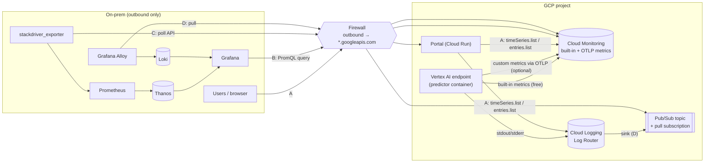
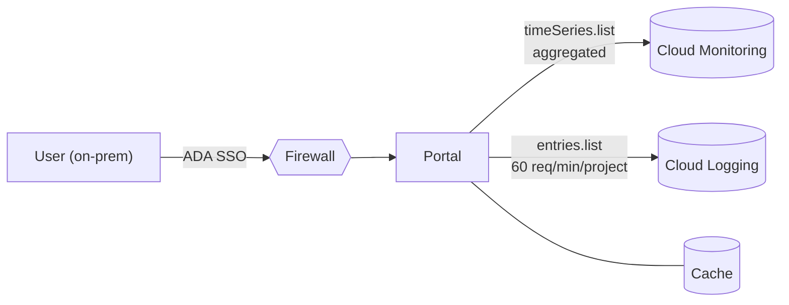
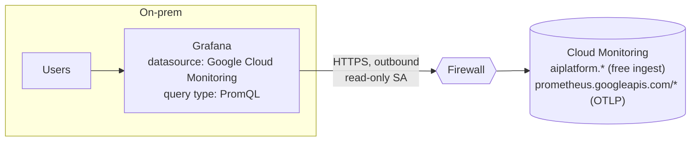
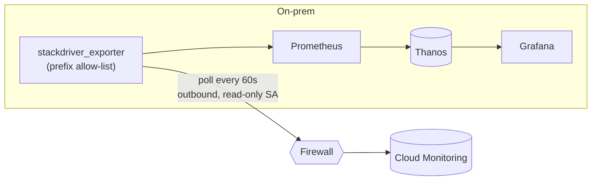
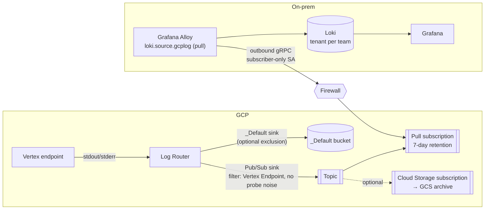
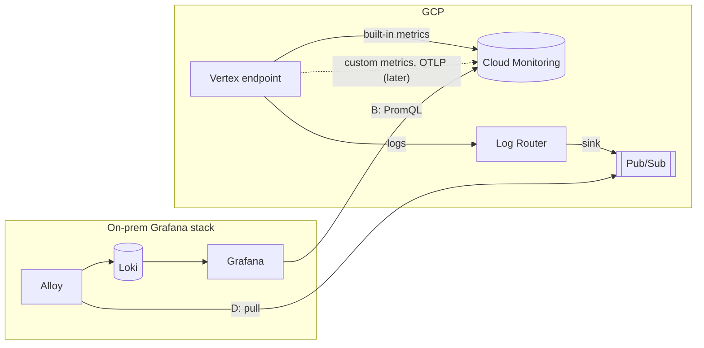

# Vertex AI endpoint logs and metrics without console access: options and recommendation

## Context

Vertex AI endpoint logs and operational metrics are visible today only in the GCP console. Users, including tech users, won't be given console access. This plan compares other ways to retrieve and render them and recommends one.

**Deliverable:** consolidate this plan into the analysis document `docs/2026-10-23-endpoint-observability-analysis.md`. Resolve the inconsistencies found in review:
- B's firewall list includes `logging.googleapis.com`, but the Logging datasource isn't recommended.
- C's cons send logs to "B or A" instead of D.
- C2 is described as needing an "inbound" rule; it's really an outbound connection from on-prem plus a public endpoint in GCP. C can also poll `prometheus.googleapis.com`, so C2 is rarely needed.
- The A1 narrow exclusion and D's full-exclusion cutover need reconciling into one exclusion strategy.

**Constraints (from clarifying answers):**
- An on-prem **Grafana + Prometheus + Thanos** stack already exists.
- **Traffic is one-way, on-prem → GCP**, through a per-destination firewall whitelist. GCP cannot push to on-prem.

**Reference APIs:**
- **Cloud Logging API v2** (https://docs.cloud.google.com/logging/docs/reference/api-overview):
  - `entries.list`, `entries.tail`, sinks, log-based metrics.
  - Google says `entries.list` is *"not intended for high-volume retrieval"*; use sinks for bulk.
  - Quotas: **`entries.list` = 60 req/min per project**; tail = 10 sessions per project, 60k entries/min.
- **Cloud Monitoring API v3** (https://docs.cloud.google.com/monitoring/api/v3):
  - `timeSeries.list`: filters plus server-side `aggregation` (alignment period, aligner, reducer, group-by).
  - `timeSeries.query` (MQL): **Google customer support for MQL ended 2025-07-22**, so don't build on it.
  - **PromQL API**: `projects.location.prometheus.api.v1` (query, query_range, series, labels, metadata), which Grafana can use as a Prometheus datasource.
  - `timeSeries.create` for custom metrics; metric descriptors.
  - Limits: 200 time series per write, 1 point per 5s per series, 30 labels per custom metric, 10k custom descriptors per project, 200k active custom series per monitored resource.
  - Retention: 24 months; original resolution for 6 weeks, then 10-minute downsampling.

## Considerations, answered

### 1. Metrics: built-in vs. custom

#### 1.1 The three categories

A metric's **cost category is set by its prefix and how it was sent**, not by what it measures. Prices are from https://cloud.google.com/stackdriver/pricing (checked 2026-10-23), list USD.

| | **Built-in** (Google Cloud metrics) | **Custom, byte-based** | **Custom, sample-based** |
|---|---|---|---|
| **Prefixes** | `aiplatform.googleapis.com/prediction/online/*` (also `run.`, `pubsub.`, `logging.googleapis.com/*`, …) | `custom.googleapis.com/*`, `workload.googleapis.com/*`, `external.googleapis.com/*`, user-defined log-based metrics | `prometheus.googleapis.com/*` (OTLP and Managed Prometheus) |
| **Who emits** | Vertex AI, automatically per endpoint / deployed model | Our predictor code | Our predictor code |
| **Covers** | Endpoint health: `prediction_count`, `response_count`, `error_count`, `prediction_latencies` (distribution → p50/p95/p99), `cpu/utilization`, `memory/bytes_used`, `accelerator/*`, `network/*_bytes_count`, `replicas`, `target_replicas` | Model and business signals: prediction-class mix, confidence histogram, feature null rate, per-consumer KPIs | Same as byte-based |
| **Code change** | None | Instrument every predictor (push only: Vertex can't scrape `/metrics` and has no sidecar) | Same as byte-based |
| **Labels** | Fixed by Google (`endpoint_id`, `deployed_model_id`, `response_code`, …) | Ours: ≤30 per metric, ≤200k active series per resource | Ours: same |
| **Metered as** | Not metered | 8 B per scalar point, 80 B per distribution point | 1 sample per scalar point; distribution = 2 + 1 per non-zero bucket (fixed) or 2 + ⌈buckets/8⌉ (exponential) |
| **Ingest price** | **Free** (doesn't use the allotment) | $0.2580 / $0.1510 / $0.0610 per MiB (tiers at 100k and 250k MiB) | $0.06 / $0.048 / $0.036 / $0.024 per M samples (tiers at 50B, 250B, 500B) |
| **Free allotment** | n/a | 150 MiB per **billing account** per month | None |
| **Answers** | "Is the endpoint healthy?" | "Is the model behaving?" | "Is the model behaving?" |
| **Use** | **Always** | Only if OTLP isn't possible | **Default for custom metrics** |

**Common to all three:**
- **Reads** are billed at $0.50 per M series returned (after 1M free per billing account). Console reads are free; Grafana and API reads aren't. See §3.
- Retention is 24 months: raw for 6 weeks, then 10-minute downsampling.
- All three are queryable through `timeSeries.list` and PromQL, so they all appear in Grafana option B.
- Built-in metrics are sampled about every 60s and visible after ~2–3 min (unverified).
- Custom write limits: 200 series per request, 1 point per 5s per series, 10k custom descriptors per project.

#### 1.2 Byte-based vs. sample-based cost

One series written once a minute = 43,200 points per month.

| Series | Byte-based | Sample-based |
|---|---|---|
| 1 scalar (e.g. null-rate gauge) | 0.33 MiB → **≈ $0.085/mo** | 43,200 samples → **≈ $0.0026/mo** |
| 1 histogram (10 non-zero fixed buckets) | 3.3 MiB → **≈ $0.85/mo** | 518k samples → **≈ $0.031/mo** |
| 1,000 histograms (e.g. 50 models × 20 label combinations) | 3,296 MiB − 150 free → **≈ $812/mo** | 518M samples → **≈ $31/mo** |

- Sample-based is **~25× cheaper for histograms**. Byte-based only wins at very low volume, because only it has a free tier.
- Cost = **series × write frequency**. Extra labels or a 10s interval multiply the bill; a bounded label allow-list is the main lever.
- User-defined log-based metrics (e.g. "ERROR lines per endpoint") are byte-based and chargeable, on top of the log storage. System-defined ones are free.

#### 1.3 How to send custom metrics

| Path | Lands as | Fit for a Vertex predictor |
|---|---|---|
| **① OTel SDK → OTLP gRPC → Telemetry API** (`telemetry.googleapis.com`) | `prometheus.googleapis.com/*`, sample-based | **Recommended.** In-process, no extra infrastructure |
| ② OTel SDK → OTel Collector ≥ 0.140.0 (`otlphttp` + `googleclientauth`) → Telemetry API | `prometheus.googleapis.com/*`, sample-based | Only if a central collector (e.g. on Cloud Run) is wanted for filtering or relabeling; adds a hop |
| ③ Monitoring API `create_time_series` (`google-cloud-monitoring`) | `custom.googleapis.com/*`, byte-based | Fallback: simplest code, but costs more |
| ④ OTel SDK → Google `CloudMonitoringMetricsExporter` | `workload.googleapis.com/*`, byte-based | Not recommended. Google is steering users to OTLP (①) |
| ✗ Ops Agent, Stackdriver Prometheus sidecar | `workload.` / `external.googleapis.com/*` | Not possible: VM-only and legacy, respectively |

**Applies to every path:**
- **Labels** come from a fixed allow-list (model, version, class). Never request IDs, user IDs or raw feature values.
- **Write every 60s**, off the request path: a periodic reader or background timer, aggregating in memory between writes.
- **Histograms** use few, explicit buckets.
- **Names:** metrics match `[a-zA-Z][a-zA-Z0-9_:./-]*`, labels match `[a-zA-Z_][a-zA-Z0-9_.]*`. Use stable names with no UUIDs.
- **Serving service account roles:**
  - ① and ②: `roles/telemetry.writer` plus `roles/serviceusage.serviceUsageConsumer`.
  - ③ and ④: `roles/monitoring.metricWriter`.
  - Enable `monitoring.googleapis.com`, plus `telemetry.googleapis.com` for ① and ②.
- **Env vars** go on the Vertex **Model** (`Model.upload`), not on the deployment.

**① OTLP direct (recommended).** Adapted from Google's Python sample; not yet run here.
```python
# deps: opentelemetry-sdk, opentelemetry-exporter-otlp-proto-grpc,
#       opentelemetry-resourcedetector-gcp, google-auth, grpcio
import google.auth, google.auth.transport.grpc, google.auth.transport.requests, grpc
from opentelemetry import metrics
from opentelemetry.exporter.otlp.proto.grpc.metric_exporter import OTLPMetricExporter
from opentelemetry.sdk.metrics import MeterProvider
from opentelemetry.sdk.metrics.export import PeriodicExportingMetricReader
from opentelemetry.sdk.resources import get_aggregated_resources
from opentelemetry.resourcedetector.gcp_resource_detector import GoogleCloudResourceDetector

credentials, _ = google.auth.default()
channel_creds = grpc.composite_channel_credentials(
    grpc.ssl_channel_credentials(),
    grpc.metadata_call_credentials(
        google.auth.transport.grpc.AuthMetadataPlugin(credentials, google.auth.transport.requests.Request())),
)
exporter = OTLPMetricExporter(credentials=channel_creds)  # endpoint from OTEL_EXPORTER_OTLP_METRICS_ENDPOINT
reader = PeriodicExportingMetricReader(exporter, export_interval_millis=60_000)
resource = get_aggregated_resources([GoogleCloudResourceDetector(raise_on_error=False)])
metrics.set_meter_provider(MeterProvider(metric_readers=[reader], resource=resource))

meter = metrics.get_meter("xgboost-census")
predicted_class = meter.create_counter("model_predictions", description="Predictions by class")
confidence = meter.create_histogram("model_confidence", description="Top-class probability")
# in /predict:  predicted_class.add(1, {"model": MODEL_NAME, "class": label})
#               confidence.record(prob, {"model": MODEL_NAME})
```
Model env vars:
- `OTEL_EXPORTER_OTLP_METRICS_ENDPOINT=https://telemetry.googleapis.com:443`. The `:443` gRPC form needs confirming.
- `OTEL_RESOURCE_ATTRIBUTES=gcp.project_id=<PROJECT>,service.name=xgboost-census`. `gcp.project_id` is required, and the detector may not recognise a Vertex replica.
- Keep exports to ≤200 points per request. The default quota is 60,000 requests/min.

**③ `custom.googleapis.com` fallback.** Follows Google's Python sample, using `generic_task`, which Google recommends over `global`.
```python
# dep: google-cloud-monitoring (already in the root pyproject)
import os, time
from google.cloud import monitoring_v3

client = monitoring_v3.MetricServiceClient()
project = f"projects/{os.environ['PROJECT_ID']}"

def write_null_rate(model: str, value: float) -> None:   # call from a 60s background timer
    series = monitoring_v3.TimeSeries()
    series.metric.type = "custom.googleapis.com/model/feature_null_rate"
    series.metric.labels["model"] = model
    series.resource.type = "generic_task"
    series.resource.labels.update({
        "project_id": os.environ["PROJECT_ID"], "location": os.environ["GCP_LOCATION"],
        "namespace": "vertex", "job": model, "task_id": os.environ.get("HOSTNAME", "0"),
    })
    now = time.time()
    series.points = [monitoring_v3.Point({
        "interval": {"end_time": {"seconds": int(now), "nanos": int((now % 1) * 1e9)}},
        "value": {"double_value": value}})]
    client.create_time_series(name=project, time_series=[series])
```
Descriptors are auto-created on first write as GAUGE with a placeholder description. Call `create_metric_descriptor` first to set the kind, unit and description.

#### 1.4 Custom *logs*

The prefixes above are metrics only. For logs, the predictor writes **one JSON object per line to stdout**. Vertex forwards stdout to Cloud Logging, and the JSON should become `jsonPayload` with `severity` honoured. That's standard structured-logging behaviour, not yet confirmed on Vertex; check with `tools/logging-cost/discover.py`. The entries then flow through the Log Router into option D, and storage in a bucket is $0.50/GiB.

#### 1.5 References

- Built-in metric list (`aiplatform` section): https://docs.cloud.google.com/monitoring/api/metrics_gcp_a_b
- User-defined metrics and prefixes: https://docs.cloud.google.com/monitoring/custom-metrics
- Pricing (categories, metering units): https://cloud.google.com/stackdriver/pricing
- OTLP metrics overview (prefix, SKU, name rules, quota): https://docs.cloud.google.com/stackdriver/docs/otlp/overview
- ① Send metrics directly from SDKs: https://docs.cloud.google.com/stackdriver/docs/otlp-metrics/use-sdks
- ② Deploy the Collector: https://docs.cloud.google.com/stackdriver/docs/otlp-metrics/deploy-collector
- Telemetry API (endpoint, auth, roles): https://docs.cloud.google.com/stackdriver/docs/reference/telemetry/overview
- ③ Create metrics with the API: https://docs.cloud.google.com/monitoring/custom-metrics/creating-metrics
- ④ Google OTel exporter (Python): https://google-cloud-opentelemetry.readthedocs.io/en/latest/examples/cloud_monitoring/README.html
- Migrating Google exporters to OTLP: https://docs.cloud.google.com/stackdriver/docs/otlp/migrate-collector-to-otlp-exporters
- Managed Service for Prometheus: https://docs.cloud.google.com/stackdriver/docs/managed-prometheus

### 2. Amount of ingested data

**Volume drivers:**
- **Logs:** verbosity × health probes × replicas, plus per-request lines. Probes log forever, even at zero traffic (`docs/2026-09-09-vertex-logging-cost.md`).
- **Built-in metrics:** fixed and free.
- **Custom metrics:** series × write frequency (§1.2).

**Constraints besides cost** (GCP limits checked 2026-10-23: [Logging quotas](https://docs.cloud.google.com/logging/quotas), [Pub/Sub quotas](https://docs.cloud.google.com/pubsub/quotas)):

| Area | Limit / risk | Mitigation |
|---|---|---|
| **Entry size** | 256 KiB per LogEntry, not increasable; oversized labels are truncated | Never log payloads or DataFrames |
| **Write rate** | 4.8 GB/min per project (`us-central1`), 300 MB/min in smaller regions. **Excluded entries still count.** | Reduce at the source; exclusions cut storage only |
| **Reads** | `entries.list` 60 req/min per project, not increasable | Use the sink → Pub/Sub path (D), not API reads |
| **Routing** | 50 exclusions per sink; 200 sinks per project | Filter by resource type and labels, not per model |
| **Pub/Sub → on-prem** | ~10 MBps per StreamingPull stream; 7-day default retention | Add Alloy replicas; alert on backlog age |
| **On-prem link** | Egress cost and shared proxy bandwidth | Size as peak entries/s × entry size |
| **Loki** | Per-tenant rate, line-size and stream limits (check on-prem `limits_config`); pushes over the limit are rejected | Bounded labels; filter noise at the sink |
| **Cardinality** | Loki streams, Prometheus/Thanos series and custom metrics all fail on labels before bytes | Fixed label allow-list everywhere |
| **Latency** | Metrics lag ~2–3 min (more via exporter); logs via Pub/Sub take seconds; the GCS sink is hourly | Choose the path by freshness need |
| **PII and residency** | Every copy (`_Default`, GCS, Pub/Sub, Loki) needs its own IAM, retention and region. Deletions span all four. | No payload logging above DEBUG; Pub/Sub storage policy |
| **Signal-to-noise** | Probe noise buries errors and slows search; synchronous logging slows `/predict` | Quiet the container; sample successes, keep all errors |

**Bottom line:** cutting volume at the source (log level, no payloads, no probe lines) is the one lever that helps cost, quotas, PII, Loki capacity and search quality at once.

### 3. Telemetry and query costs, including high cardinality

**Prices.** Checked 2026-10-21 against https://cloud.google.com/stackdriver/pricing. List prices, in USD, with no discounts.

| Item | Price | Free allotment per month | Effective |
|---|---|---|---|
| Monitoring ingest | Built-in free; custom byte-based or sample-based (prices and tiers in **§1.1**) | See §1.1 | n/a |
| Monitoring **read** API (`timeSeries.list`, PromQL, …) | **$0.50 per million time series returned**. Each call is billed as max(series returned, 1). | First 1M time series per **billing account** | 2025-10-02 |
| Monitoring write API (`timeSeries.create`) | No charge | n/a | n/a |
| Monitoring alerting policies | $0.35/month per metric reference, plus $0.50 per M points returned by condition queries | n/a | **2027-09-01** (future) |
| Logging storage (ingest) | $0.50/GiB, one-time, includes 30 days in log buckets. **"No additional charges for querying and analyzing log data."** | First 50 GiB per **project** | 2018-07-01 |
| Logging retention beyond 30 days | $0.01/GiB per month | n/a | 2022-01-01 |
| Log Router (sinks) | No charge; the destination's storage charges apply | n/a | n/a |
| Log Analytics (upgrade + SQL from the Log Analytics page) | No charge | n/a | n/a |
| Logging `entries.list` | No charge, but **quota: 60 req/min per project** | n/a | n/a |
| Linked BigQuery dataset queries | BigQuery on-demand rates (not on this page) | n/a | n/a |

**Key detail for the Grafana options:**
- Read calls from the **Google Cloud console are free**.
- Calls from the gcloud CLI, client libraries and "third-party tools like Grafana" are **billed**.
- Moving users off the console onto Grafana or the portal turns a free read path into a metered one.
- Track it with the `time_series_billed_for_queries_count` metric.

**The high-cardinality risk is on the read side:**
- Read cost scales as dashboards × panels × series returned × refresh rate.
- Example: 20 endpoints × 3 deployed models × 5 response codes × 6 metrics gives ~1,800 series per refresh.
- A 30s refresh across 10 viewers returns ~51.8M series per day, or ~1.56B per month.
- That's **≈ $777/month** in read charges, after the 1M free.
- The same panels aggregated to `sum by (endpoint_id)` (20 × 6 = 120 series) at a 1-minute refresh across 10 viewers cost ≈ $25/month.
- Behind a single poller or cache (one refresh per minute regardless of viewers), they cost ≈ $2.10/month.
- Mitigations:
  - Always aggregate server-side (`alignment_period` ≥ 60s, a reducer, explicit `group_by`).
  - Never chart per-replica or per-response-code series unbounded.
  - Put a cache or a single poller in front of the API.
- For logs, the binding constraint is the **60 req/min quota**, not cost. Many users paging logs directly through `entries.list` would exhaust it project-wide, and that quota is shared with anything else in the project.

## Options

**At a glance.** Every arrow starts on-prem or inside GCP; nothing pushes from GCP into on-prem.



| Option | Signal | One-line summary | Build effort |
|---|---|---|---|
| **A** Portal UI | Metrics + logs | The portal calls the Monitoring/Logging APIs and renders its own charts and log table | High |
| **B** Grafana → Cloud Monitoring | Metrics | On-prem Grafana queries Cloud Monitoring live with PromQL | **Low** |
| **C** Exporter → Thanos | Metrics | An on-prem exporter polls Cloud Monitoring into Prometheus/Thanos | Medium |
| **D** Sink → Pub/Sub → Loki | Logs | Logs are streamed by a Log Router sink; on-prem Alloy pulls them into Loki | Medium |

---

### A. Portal UI on the Logging and Monitoring APIs

**What:** the portal (in GCP) calls `timeSeries.list` (aggregated) and `entries.list`, then renders charts and a log table itself. Users never touch GCP.



**How to implement**
1. Portal service account: `roles/monitoring.viewer`, `roles/logging.viewer`.
2. Metrics API: always send `aggregation` (`alignmentPeriod` ≥ 60s, `ALIGN_RATE` / `ALIGN_PERCENTILE_95`, `crossSeriesReducer` + `groupByFields`).
3. Logs API: validate every input that goes into the filter, page with `pageToken`, and cache responses for 30–60s keyed by query.
4. Authorization: map the ADA SSO group to permitted `endpoint_id`s before querying.
5. Frontend: a chart library plus a log table with time picker and severity filter.

**Pros**

- One URL, one auth model (ADA SSO/portal). Users need no GCP identity.
- Per-model authorization is enforceable, so a user sees only their models' logs. The PII in logs makes this matter.
- Only the existing GCP API destinations need whitelisting.
- Full control over aggregation and caching, so read cost and cardinality are bounded by design.

**Cons**
- Building charts, time pickers, log search and pagination means reinventing Grafana.
- Logs hit the 60 req/min `entries.list` quota, so the portal needs caching, rate limiting, or a log sink → BigQuery/Log Analytics for search.
- No alerting, ad-hoc exploration or cross-system correlation with on-prem dashboards.

**Making A work with exclusions.** `entries.list` reads **log buckets** only. A works as long as the logs users need land in *some* bucket.

| Approach | How | Cost effect | Fit |
|---|---|---|---|
| **A1: Narrow exclusion (recommended)** | Exclude only the noise from `_Default`: health-probe and access-log lines, by `logName` or text match, optionally `sample(insertId, 0.9)` for high-volume INFO. App logs, warnings and errors stay. | Most of the saving, since probe lines are the bulk of idle volume | **Best.** No new components; the portal keeps working unchanged |
| **A2: Dedicated log bucket + log views** | Exclude Vertex logs from `_Default`, add a sink to a **user-defined log bucket** (own region and retention). Create one **log view per model/team** (filter on `endpoint_id`). The portal calls `entries.list` with `resource_names=["projects/P/locations/L/buckets/B/views/V"]`. | No saving: $0.50/GiB applies to any log bucket. Gains residency, retention and access control. | When per-model access control in GCP matters (`roles/logging.viewAccessor` conditioned on the view) |
| A3: BigQuery sink | Sink to a BigQuery dataset; the portal queries partitioned tables by `endpoint_id` and time | BigQuery storage plus query bytes scanned (rates not verified here) instead of $0.50/GiB | Larger volumes or analytical queries. Not limited by the 60 req/min `entries.list` quota |
| A4: Portal consumes Pub/Sub | A second subscription on D's topic → the portal writes to its own store (e.g. Firestore/Cloud SQL) | Pub/Sub throughput plus our store | Rarely worth it: it rebuilds Loki inside the portal |

- **Not possible:** the portal reading the GCS archive interactively (hourly batches, no query engine) or on-prem Loki (GCP can't reach on-prem).
- **The quota still applies to A1 and A2.** `entries.list` is 60 req/min per project, so the portal must still cache and rate-limit. A3 avoids it.
- **Exclusion filters** support `sample()` and up to 50 exclusions per sink. Keep each exclusion narrow and `resource.type`-scoped. Run `tools/logging-cost/discover.py` to find the noisy `logName`s before excluding.

### B. On-prem Grafana queries Cloud Monitoring directly (recommended for metrics)

**What:** add the built-in **Google Cloud Monitoring** datasource (listed as `stackdriver`) to the existing on-prem Grafana and query it with **PromQL**. The data stays in GCP; Grafana reads it live on each refresh. Built-in metrics and OTLP custom metrics are both queryable.



**How to implement**
1. Create a read-only service account with `roles/monitoring.viewer` only. Use Workload Identity Federation if Grafana supports it in your setup; otherwise use a key held in Grafana's secret store.
2. Firewall: allow outbound to `monitoring.googleapis.com` and `oauth2.googleapis.com` (or the `private.googleapis.com` /30).
3. Grafana: *Connections → Add data source → Google Cloud Monitoring → Google JWT File*, then *Save & test*.
4. Dashboards: query type **PromQL**, one expression per query. Always aggregate (`sum by (endpoint_id)`, `histogram_quantile` over `rate(...[5m])`). Set *Min interval* to 1m and dashboard refresh to 1m or more.
5. Access: one Grafana folder per team, filtered with an `endpoint_id` variable.
6. Cost guard: watch `monitoring.googleapis.com/billing/time_series_billed_for_queries_count`.

(Alternative: a plain *Prometheus* datasource pointed at the Monitoring PromQL HTTP API. That needs a token-refresh proxy, so prefer the native datasource.)

**Pros**
- Reuses the existing stack: dashboards, alerting, Thanos-side correlation and the team's PromQL skills. Near-zero build.
- Pull-only, so it fits the one-way network. Firewall needs: `monitoring.googleapis.com`, `logging.googleapis.com`, `oauth2.googleapis.com`, or the `private.googleapis.com` /30.
- No extra ingest. Built-in metrics stay free.

**Cons**
- Grafana's single service account sees **all** project metrics. Per-model scoping relies on Grafana folder and dashboard permissions, which is coarser than the portal. Metrics carry no PII, so this is acceptable.
- Every dashboard refresh is a billable read ($0.50 per million series). Bound it with aggregation, minimum interval and refresh limits.
- Metrics stay in GCP, not Thanos. History follows GCP retention (24 months, downsampled after 6 weeks).
- Don't add the Cloud Logging datasource the same way: it's project-wide and the logs carry PII. Use D for logs.

### C. Exporter → on-prem Prometheus/Thanos

**What:** an exporter **running on-prem** polls the Cloud Monitoring API on a fixed schedule and re-exposes the series as Prometheus metrics. The existing Prometheus scrapes them into Thanos. A push from GCP (`remote_write`, OTLP, Thanos Receive) is **not possible** with the one-way network.



**How to implement**
1. Use the same read-only service account and firewall entries as B.
2. Deploy `prometheus-community/stackdriver_exporter` on-prem with:
   - The project (`--google.project-ids` in recent releases, `--google.project-id` in older ones; check `--help`)
   - `--monitoring.metrics-type-prefixes=aiplatform.googleapis.com/prediction/online` (plus `prometheus.googleapis.com/model_` if custom metrics exist)
   - `--monitoring.metrics-interval=5m`
   - `--monitoring.metrics-offset=3m` to absorb GCP's ingest delay
3. Add a Prometheus scrape job for the exporter, with a scrape interval of 60s or more.
4. In Prometheus, add recording rules for p95 latency and error rate per endpoint, and drop unused labels with `metric_relabel_configs`.
5. Point dashboards at the Thanos datasource.

(A variant, C2: an OTel Collector in GCP exposing `/metrics` for custom metrics, which on-prem scrapes inbound. This needs an inbound firewall rule and a public authenticated endpoint. It's only needed if custom metrics must bypass Cloud Monitoring.)

**Pros**
- Metrics land in Thanos: one long-term store, consistent retention, recording rules and downsampling, and correlation with on-prem services.
- The exporter polls on a fixed schedule regardless of viewer count, so read cost is predictable. Many viewers read Thanos, not GCP.
- C2 is the only clean path for container custom metrics into on-prem.

**Cons**
- More moving parts, all owned by us: the exporter's config, metric prefix allow-lists, and keeping lag and polling cost tuned. C2 adds a public, authenticated scrape endpoint in GCP plus a new firewall rule.
- Polling lag of 1–5 minutes, plus GCP metrics' own 2–3 minute delay.
- Cardinality explosion moves into Thanos if the exporter isn't filtered to specific metric prefixes and labels.
- **Logs aren't covered.** Thanos is metrics-only, so logs still need B (Grafana Logging datasource) or A.
- C2 makes custom metrics a container code change (an OTel SDK push), and Vertex gives no scrape or sidecar.

### D. Logs: Log Router sink → Pub/Sub → on-prem Loki (recommended for logs)

**What:** instead of polling `entries.list`, which Google says is "not intended for high-volume retrieval", a **Log Router sink** streams matching Vertex log entries into a Pub/Sub topic. On-prem **Grafana Alloy pulls** the subscription, which is outbound only, and writes to Loki. Users read the logs in the existing Grafana, scoped per team.



**How to implement (summary).** Full steps and commands are below.
1. Create the topic and the sink (filtered to `resource.type="aiplatform.googleapis.com/Endpoint"`, without health-probe lines). Grant the sink's writer identity `pubsub.publisher` on the topic.
2. Create a **pull** subscription with 7-day retention. Give the on-prem service account `pubsub.subscriber` on that subscription only.
3. Firewall: allow outbound to `pubsub.googleapis.com` and `oauth2.googleapis.com`.
4. Alloy: `loki.source.gcplog` (pull) → relabel `endpoint_id`/`severity` → `loki.write` to Loki, with one tenant per team.
5. Grafana: Loki datasource and per-team folders. Alert on subscription backlog age.
6. Optional: a Cloud Storage subscription for the archive; an exclusion on `_Default` once Loki is trusted.

**Pros**
- No `entries.list` quota (60 req/min) involved. Near-real-time.
- Logs carrying PII stay scoped per team in Loki. Grafana never gets project-wide log access.
- Cheap: Pub/Sub $40/TiB (about $7/month per 100 GiB) plus egress. It can replace the $0.50/GiB `_Default` storage via an exclusion.
- Buffered: an on-prem outage loses nothing within the retention window.

**Cons**
- We run new pieces (sink, topic, Alloy, Loki capacity).
- Loki storage and retention become our responsibility on-prem.
- If `_Default` is excluded, logs disappear from Logs Explorer.

**Sink destinations in detail.** Destinations are Pub/Sub, BigQuery, Cloud Storage, or another log bucket. With traffic flowing only from on-prem to GCP, on-prem must **pull**, so:

| Variant | Path | Use for | Fit |
|---|---|---|---|
| **D1: Pub/Sub pull → on-prem Loki** | sink → Pub/Sub topic → **pull** subscription → Grafana Alloy `loki.source.gcplog` (pull mode) on-prem → Loki → Grafana | Near-real-time log viewing and search for tech users, in the Grafana they already use | **Recommended** |
| D2: Log Analytics bucket / linked BigQuery | sink → user-defined log bucket with Log Analytics (+ linked BigQuery dataset) → portal or Grafana BigQuery datasource runs SQL | Ad-hoc SQL and aggregations ("errors per model per day") | Complements D1 |
| D3: Cloud Storage | sink → GCS (hourly JSON files) → batch pull | Archive and compliance only; not interactive | Optional |

**Combining Pub/Sub with Cloud Storage.** There are two patterns.

| Pattern | Path | Latency | Notes |
|---|---|---|---|
| **P1: Pub/Sub fan-out (recommended if an archive is needed)** | sink → Pub/Sub topic → **(a)** pull subscription → on-prem Loki, **and (b)** a **Cloud Storage subscription** → GCS archive bucket | Seconds (Loki); minutes (GCS files) | One sink and one topic serve both. A Cloud Storage subscription costs **$50/TiB**, with **no free 10 GiB**, plus GCS storage. Batching, file size and prefix are configurable on the subscription. |
| P2: GCS sink + bucket notifications | sink → GCS bucket → Pub/Sub notification (`OBJECT_FINALIZE`) → pull subscription → on-prem worker reads the object name and downloads the file from `storage.googleapis.com` → pushes it to Loki | **Hours.** Sinks write **hourly batches**, and the first files take **2–3 h**. | Notifications carry only metadata, not log lines, so on-prem needs a custom downloader (no standard Alloy source). Needs `roles/storage.objectViewer` and an extra firewall entry. Late entries arrive as addendum shards (`..._A0:<ts>.json`). The cheapest path (GCS storage only), but batch-only. |

- P2 suits compliance archive or batch loading into on-prem storage only; it can't power live log views.
- For live viewing plus archive, use P1. A separate GCS **sink** (D3) beside the Pub/Sub sink also works, but it's two independently filtered rules to keep in sync.
- Sources: https://docs.cloud.google.com/logging/docs/export/storage (hourly batches, 2–3 h first delay, file naming) and https://cloud.google.com/pubsub/pricing (Cloud Storage subscription $50/TiB). Both checked 2026-10-23.

**Does Pub/Sub still work with an exclusion on `_Default` and a GCS sink? Yes.**

```
Logging API ─► Log Router ─┬─► _Default sink (exclusion: Vertex endpoint) ─► _Default bucket   ✗ dropped
                           ├─► GCS sink        (own filter)                ─► GCS bucket        ✓
                           ├─► Pub/Sub sink    (own filter)                ─► topic → on-prem   ✓
                           └─► _Required sink  (audit logs; cannot be excluded)                ✓
```
- **Sinks are evaluated independently.** An exclusion lives on a single sink and drops entries only from *that* sink's destination; every other sink still sees every entry the Log Router receives.
- This repo already measured it on the live endpoint: with the `_Default` exclusion applied, the GCS sink kept receiving the excluded logs (`docs/2026-09-09-vertex-logging-cost.md` §5; `docs/logs-exclusion-gcs-sink.md` Step 7d).
- **Consequences of excluding from `_Default`:**
  - No $0.50/GiB bucket storage for those entries.
  - They disappear from Logs Explorer and from `entries.list`: any API-based log view returns nothing for them, so Loki (via Pub/Sub) or GCS becomes the only copy.
  - `billing/bytes_ingested` still counts them (measured). It isn't a valid signal for whether the exclusion is working.
- **Requirements:**
  - The Pub/Sub sink must be its **own sink** (D1), or use P2 (GCS notifications) if hourly latency is acceptable.
  - The Pub/Sub sink and GCS sink filters must cover everything the exclusion drops, otherwise those entries are lost from every destination.
  - Scope the exclusion to `resource.type="aiplatform.googleapis.com/Endpoint"`; never project-wide.

**Impact on each option of a `_Default` exclusion plus a GCS sink.** Metrics are unaffected; logs change materially.

| Option | Effect | Why |
|---|---|---|
| A: portal `entries.list` | **Stops working** for Vertex logs | `entries.list` reads log buckets only; excluded entries never reach `_Default` |
| B with the Grafana Cloud Logging datasource | **Empty** | Same reason. Logs Explorer is also empty, including for the platform team |
| B / C (metrics) | Unchanged | Metrics don't pass through log sinks |
| D (Pub/Sub sink) | **Works, and becomes the only interactive copy** | Every sink sees every entry independently |
| GCS sink | Archive only | Hourly JSON batches, 2–3 h first delay. Not queryable by Loki or Grafana without loading into BigQuery |

What to add or decide:
1. **Make the Pub/Sub sink a separate sink beside the GCS sink.** Don't use GCS bucket notifications: they're hourly, carry metadata only, and need a custom downloader.
2. **Keep the two filters in sync.** Anything excluded from `_Default` that neither sink matches is lost everywhere.
3. **Keep the GCS sink rather than switching to a Pub/Sub Cloud Storage subscription.** Log Router routing is free and writes to GCS carry no Class A charges, whereas a Cloud Storage subscription costs $50/TiB with no free tier.
4. **Size Loki retention for incident debugging.** It's the only searchable copy; GCS covers anything older, but slowly.
5. **Expect no backfill.** Pub/Sub only delivers entries routed after the sink exists. Older logs are only in GCS, so loading them into Loki needs a one-off job.
6. **Verify via `storage_bytes` and Loki/GCS arrival, not `billing/bytes_ingested`.** The ingest metric still counts excluded entries (measured).
7. **Logs-based metrics (unverified):** check whether a user-defined logs-based metric still counts entries excluded from `_Default` before relying on one.

Indicative cost at 100 GiB/month of endpoint logs:

| Item | Without exclusion | With exclusion + GCS + Pub/Sub |
|---|---|---|
| `_Default` storage | ~$50 (above the 50 GiB free) | $0 |
| GCS archive (Standard) | n/a | ~$2 per month of data kept, before lifecycle tiering |
| Pub/Sub throughput | ~$7.40 | ~$7.40 |
| Egress to on-prem | Unverified | Unverified |

**Where Pub/Sub stores the data, and for how long.** Pub/Sub is a durable **buffer**, not a log store.

- **Lifecycle:**
  - A published message is stored and replicated for durability until it's delivered.
  - Once **every** subscription attached to the topic has acknowledged it, it isn't redelivered and is removed (unless *retain acknowledged messages* is on).
  - With the optional fan-out (Loki pull subscription + Cloud Storage subscription), a message stays until **both** have acked it.
- **Subscription retention** (unacknowledged messages): default **7 days**, configurable from **10 minutes to 31 days**. This is the on-prem outage window: if Alloy is down longer than this, those logs are lost from the Pub/Sub path and exist only in GCS.
- **Retaining acknowledged messages and topic retention** (optional) let you `seek` back and replay, e.g. to rebuild Loki after data loss. Both are billed as storage at **$0.27/GiB per month**. Leave them off unless replay is a requirement; GCS is the cheaper replay source.
- **Location: the topic itself isn't tied to a region.**
  - With the global endpoint, messages are stored in **"the nearest Google Cloud region"** to where they enter Google Cloud. For a Log Router sink, Google is the publisher, so we don't choose that region.
  - Without a policy, the effective Resource Location Restriction org policy applies; if none exists, **all regions are allowed**.
- **Data-residency control** (relevant because the logs can carry PII):
  - Set a **message storage policy** on the topic listing the approved region(s), e.g. `us-central1`, to match the endpoint and archive bucket.
  - Set `enforceInTransit=true` so that publish, pull and StreamingPull requests received in disallowed regions are rejected (`FAILED_PRECONDITION`).
  - On-prem Alloy must then use a **regional/locational endpoint** in an allowed region.
  - Policy changes apply only to messages published afterwards.
- **Sources** (checked 2026-10-23): https://docs.cloud.google.com/pubsub/docs/subscription-properties (retention default/min/max, retain acked) · https://docs.cloud.google.com/pubsub/docs/resource-location-restriction (nearest-region storage, storage policy, `enforceInTransit`) · https://cloud.google.com/pubsub/pricing ($0.27/GiB per month storage).

```bash
# residency + outage window, added to the D1 setup
# (confirm the enforce-in-transit flag name with `gcloud pubsub topics update --help`)
gcloud pubsub topics update vertex-endpoint-logs \
  --message-storage-policy-allowed-regions=us-central1 \
  --message-storage-policy-enforce-in-transit
gcloud pubsub subscriptions update vertex-endpoint-logs-onprem --message-retention-duration=7d
```

**D1 setup.** Steps 1–5 run once in GCP; steps 6–7 run on-prem.

1. **Create the Pub/Sub topic** (`vertex-endpoint-logs`). This is the buffer between Cloud Logging and on-prem.
2. **Create the Log Router sink.** Its destination is the topic, and its inclusion filter is `resource.type="aiplatform.googleapis.com/Endpoint"`, tightened further to drop health-probe and access-log noise (use the log IDs found by `tools/logging-cost/discover.py`). Every entry the Logging API receives that matches the filter is published to the topic. No `timestamp` or `location` predicates, so the rule keeps matching.
3. **Authorize the sink.** Each sink gets a service-account *writer identity*. Grant it `roles/pubsub.publisher` on **this topic only**, not project-wide.
4. **Create a pull subscription** (`vertex-endpoint-logs-onprem`):
   - It must be **pull, not push**: push would need GCP to reach on-prem, which the network doesn't allow.
   - Ack deadline: 60s.
   - Message retention: 7 days, which covers an on-prem outage or maintenance window.
   - Optionally add a dead-letter topic for messages that repeatedly fail to process.
5. **Create the on-prem consumer identity:**
   - A dedicated service account with `roles/pubsub.subscriber` on **this subscription only**. It has no Logging or project roles.
   - Prefer Workload Identity Federation against the corporate IdP. If you must use a key, store it in the on-prem secret store and rotate it.
6. **Open the firewall:**
   - Allow outbound from the Alloy hosts to `pubsub.googleapis.com:443` and `oauth2.googleapis.com:443` (or the `private.googleapis.com` /30).
   - Pull is a client-initiated gRPC/HTTPS stream, so no inbound rule is needed.
7. **Configure Grafana Alloy on-prem:**
   - The `loki.source.gcplog` component in `pull` mode reads the subscription and acks each message after forwarding it.
   - A `loki.relabel` block maps `__gcp_resource_labels_endpoint_id`, `__gcp_resource_labels_deployed_model_id`, `__gcp_severity` and `__gcp_logname` to Loki labels. Keep labels low-cardinality: never request IDs.
   - `loki.write` sends to the on-prem Loki, with a tenant or team label used for access control.
8. **Expose it in Grafana:**
   - Add Loki as a datasource and build per-model log panels.
   - Restrict folders or tenants so each team sees only its own endpoints.
9. **Monitor the pipeline:**
   - Alert on `pubsub.googleapis.com/subscription/oldest_unacked_message_age`, which signals that on-prem has stopped consuming.
   - Also alert on dead-letter growth, and on sink `exports/error_count`.
10. **Cut over (optional):** once Loki is validated as the system of record, add an exclusion with the same filter to `_Default` so the $0.50/GiB bucket storage stops. Keep `_Default` during validation.

Reference commands:
```bash
gcloud pubsub topics create vertex-endpoint-logs
gcloud logging sinks create vertex-endpoint-logs-to-pubsub \
  pubsub.googleapis.com/projects/$PROJECT_ID/topics/vertex-endpoint-logs \
  --log-filter='resource.type="aiplatform.googleapis.com/Endpoint"'
# grant the sink's writerIdentity publish rights on the topic only
gcloud pubsub topics add-iam-policy-binding vertex-endpoint-logs \
  --member="$(gcloud logging sinks describe vertex-endpoint-logs-to-pubsub --format='value(writerIdentity)')" \
  --role=roles/pubsub.publisher
gcloud pubsub subscriptions create vertex-endpoint-logs-onprem \
  --topic=vertex-endpoint-logs --ack-deadline=60 --message-retention-duration=7d
# on-prem consumer identity: subscriber on this subscription only
gcloud pubsub subscriptions add-iam-policy-binding vertex-endpoint-logs-onprem \
  --member=serviceAccount:onprem-log-reader@$PROJECT_ID.iam.gserviceaccount.com \
  --role=roles/pubsub.subscriber
```
```alloy
// on-prem Grafana Alloy
loki.source.gcplog "vertex" {
  pull {
    project_id   = "PROJECT_ID"
    subscription = "vertex-endpoint-logs-onprem"
  }
  forward_to    = [loki.write.onprem.receiver]
  relabel_rules = loki.relabel.vertex.rules   // map __gcp_resource_labels_endpoint_id etc. to Loki labels
}
```
- **Firewall:** `pubsub.googleapis.com` and `oauth2.googleapis.com` (or the private.googleapis.com /30). Pull uses outbound gRPC/HTTPS only.
- **Access control:** use Loki multi-tenancy or label-based access (`endpoint_id`/team) to scope users to their models. That handles the PII concern without giving Grafana project-wide Cloud Logging access.
- **Avoid paying twice:** if Loki becomes the system of record, add an exclusion on `_Default` for the same filter. Logs routed only to Pub/Sub aren't stored in log buckets, so the $0.50/GiB doesn't apply, but you lose Logs Explorer for them. Keep `_Default` while validating.
- **Filter at the sink:** drop health-probe and access noise in `--log-filter`. Pub/Sub throughput is billed on everything published.
- **Reliability:** if on-prem is down, messages wait in the subscription (7 days as configured). Add a dead-letter topic and alert on `subscription/oldest_unacked_message_age`.

**Pub/Sub cost** (checked 2026-10-21, https://cloud.google.com/pubsub/pricing):
- Message delivery: $40/TiB of throughput, covering both publish and subscribe. The first 10 GiB per billing account per month is free.
- Each request is billed at a minimum of 1 KB.
- Retained-message storage: $0.27/GiB per month.
- Network egress from GCP to on-prem also applies. That rate isn't verified here and depends on the internet vs. Interconnect path.
- Example: 100 GiB/month of endpoint logs is ≈ 200 GiB of throughput (publish + subscribe), or **≈ $7.4/month** plus egress, compared with $50/month to store the same 100 GiB in `_Default` beyond the free tier.

## Recommendation



| Signal | Choose | Why | Revisit when |
|---|---|---|---|
| **Metrics** | **B**: Grafana → Cloud Monitoring (PromQL) | Lowest build, fits the one-way network, free ingest, already proven locally | Read cost grows with viewers, or retention > 24 months / on-prem correlation is needed → move to **C** |
| **Logs** | **D**: sink → Pub/Sub → Alloy → Loki | Avoids the `entries.list` quota, keeps PII scoped per team, cheap | SQL analytics needed → add a Log Analytics/BigQuery sink |
| **Custom model metrics** | **Defer.** When needed: OTel SDK → OTLP (gRPC) → Telemetry API | Sample-based (~25× cheaper for histograms); appears in B with no new infrastructure | Must live in Thanos → C2 |
| **Portal (A)** | Links into Grafana dashboards; no chart building | Avoids rebuilding Grafana | Non-tech users need an in-portal summary → small aggregated view only |

**Rollout order:** B (days) → D (1–2 weeks incl. firewall) → custom metrics (on demand).

## Local test setup (MacBook)

Goal: try B (metrics via PromQL) and D (logs via Pub/Sub → Alloy → Loki) end to end on a laptop before asking on-prem for anything. The laptop stands in for on-prem: outbound to Google APIs only, nothing inbound.

**Prerequisites**
- Docker runtime: Docker Desktop, or `brew install colima docker docker-compose && colima start`.
- A **dedicated test service account** with read-only roles: `roles/monitoring.viewer` for B, plus `roles/pubsub.subscriber` on the test subscription only for D. Download its key to a folder **outside the repo**, e.g. `~/grafana-local/keys/sa.json`. Don't reuse the deploy key, and delete the key after testing.
- For D1: GCP setup steps 1–5 above done in `mle-project-496007`, plus some endpoint traffic so logs exist (e.g. `service/tests/call_endpoint.py`).

**Layout:** `~/grafana-local/`
```
docker-compose.yml
config.alloy
provisioning/datasources/loki.yml
keys/sa.json        # chmod 600, never committed
```

**docker-compose.yml**
```yaml
services:
  grafana:
    image: grafana/grafana:latest        # pin to the on-prem version once known
    ports: ["3000:3000"]
    volumes:
      - ./provisioning:/etc/grafana/provisioning
  loki:
    image: grafana/loki:latest
    ports: ["3100:3100"]
    command: -config.file=/etc/loki/local-config.yaml   # single-binary default config in the image
  alloy:
    image: grafana/alloy:latest
    ports: ["12345:12345"]                # Alloy UI: component health/debug
    environment:
      GOOGLE_APPLICATION_CREDENTIALS: /keys/sa.json
    volumes:
      - ./config.alloy:/etc/alloy/config.alloy
      - ./keys:/keys:ro
    command: run --server.http.listen-addr=0.0.0.0:12345 /etc/alloy/config.alloy
    depends_on: [loki]
```

**config.alloy (D1)**
```alloy
loki.source.gcplog "vertex" {
  pull {
    project_id   = "mle-project-496007"
    subscription = "vertex-endpoint-logs-onprem"
    use_incoming_timestamp = true
  }
  forward_to    = [loki.write.local.receiver]
  relabel_rules = loki.relabel.vertex.rules
}

loki.relabel "vertex" {
  forward_to = []
  rule {
    source_labels = ["__gcp_resource_labels_endpoint_id"]
    target_label  = "endpoint_id"
  }
  rule {
    source_labels = ["__gcp_severity"]
    target_label  = "level"
  }
  rule {
    source_labels = ["__gcp_logname"]
    target_label  = "log_name"
  }
}

loki.write "local" {
  endpoint { url = "http://loki:3100/loki/api/v1/push" }
}
```
> Label names `__gcp_logname`, `__gcp_severity` and `__gcp_resource_labels_<name>` come from the Promtail `gcplog` docs. The Alloy reference page doesn't list them, so confirm in the Alloy UI (`localhost:12345`), which shows each component's incoming labels.

**provisioning/datasources/loki.yml**
```yaml
apiVersion: 1
datasources:
  - name: Loki (local)
    type: loki
    access: proxy
    url: http://loki:3100
```

**Run and test**
1. `cd ~/grafana-local && docker compose up -d`, then open http://localhost:3000 (admin/admin; change it at the prompt).
2. **B, metrics:**
   1. Go to *Connections → Data sources → Add → Google Cloud Monitoring*.
   2. Set authentication to *Google JWT File* and upload `keys/sa.json`.
   3. Choose *Save & test*.
   4. In Explore, the datasource picker (top-left) lists the Cloud Monitoring datasource as **`stackdriver`** (its legacy type name). Select it. Then, **in the query row below**, open the **Query type** drop-down (it defaults to *Builder*), choose **PromQL**, select the **Project**, and run:
      **One PromQL expression per query row.** Two lines in one box parse as a single expression and fail with `unexpected <aggr:sum>`. Use **+ Add query** for the second.

      Query A, p95 latency:
      ```promql
      histogram_quantile(0.95, sum by (le, endpoint_id) (rate(aiplatform_googleapis_com:prediction_online_prediction_latencies_bucket{monitored_resource="aiplatform.googleapis.com/Endpoint"}[5m])))
      ```
      Query B, prediction rate:
      ```promql
      sum by (endpoint_id) (rate(aiplatform_googleapis_com:prediction_online_prediction_count{monitored_resource="aiplatform.googleapis.com/Endpoint"}[5m]))
      ```
      Start with a bare selector (e.g. `aiplatform_googleapis_com:prediction_online_prediction_count`) to confirm the name resolves before adding functions.
      Metric names follow the Cloud Monitoring → PromQL mapping (`.`→`_`, first `/`→`:`, remaining `/`→`_`). If a name doesn't resolve, use the metric browser.
3. **D, logs:**
   1. Send a few predictions, then wait about a minute.
   2. In Explore, select *Loki (local)* and run `{endpoint_id="<ENDPOINT_ID>"}`.
   3. Check that entries appear with the `level`/`log_name` labels.
   4. Run `gcloud pubsub subscriptions describe vertex-endpoint-logs-onprem` and check the backlog drains.
4. **Cost check:** after an hour of dashboard use, read `monitoring.googleapis.com/billing/time_series_billed_for_queries_count` in Metrics Explorer. It shows the number of series the Grafana panels were billed for.

**Teardown:** run `docker compose down -v`. Delete the test SA key (`gcloud iam service-accounts keys delete ...`). Delete the subscription, topic and sink if the test is over.

## Verification before committing to this

- List prices were checked on 2026-10-21. Next, confirm against our billing account: contract discounts, and whether the 1M free read allotment and the 150 MiB free metric ingest are already used by other projects on the same **billing account**.
- Spike B from on-prem (already working locally):
  - Use the Google Cloud Monitoring datasource with the PromQL query type, through the firewall.
  - Chart p95 latency and prediction rate for one endpoint.
  - Record the series returned per refresh.
- Spike D:
  - Create the topic, sink and subscription.
  - Run Alloy on-prem through the firewall and confirm entries land in Loki with `endpoint_id` labels.
  - Measure the monthly volume, using the Pub/Sub `topic/byte_cost` metric, against the cost estimate.
  - Confirm the GCP → on-prem egress rate.
- Confirm Grafana's Google auth options for on-prem: a service account key versus Workload Identity Federation against the corporate IdP. Federation is preferred because it keeps keys off disk.
